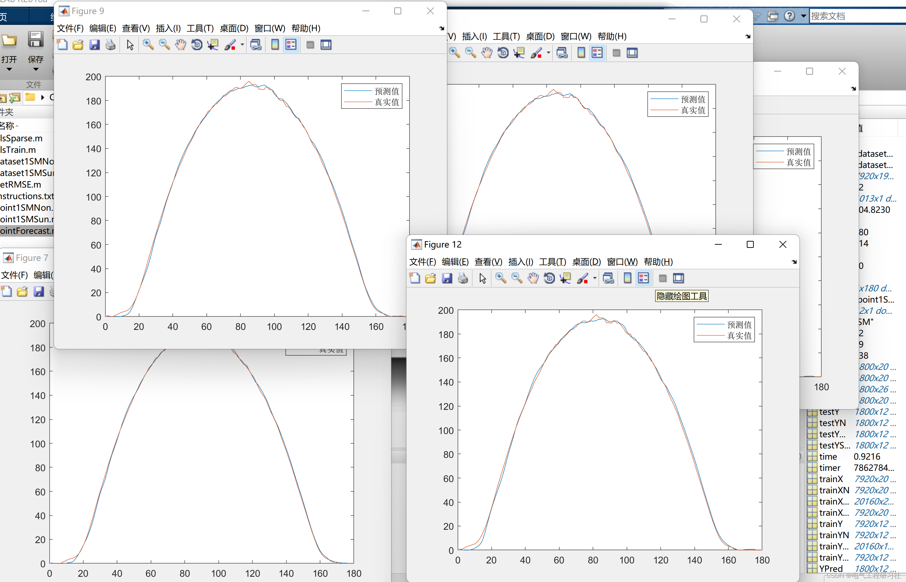
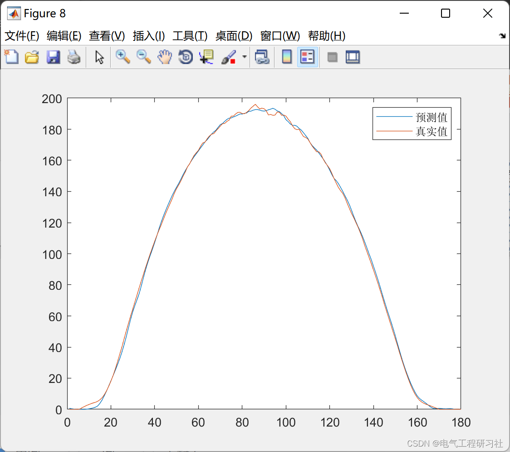
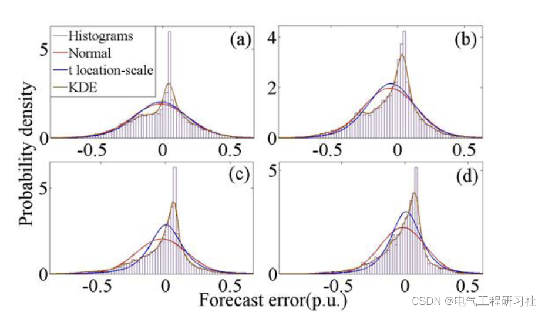
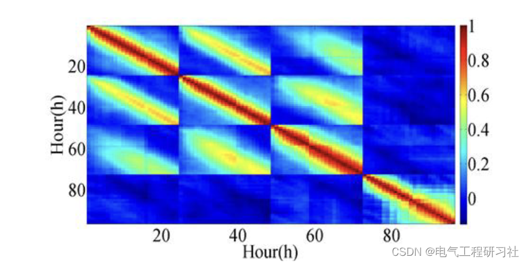
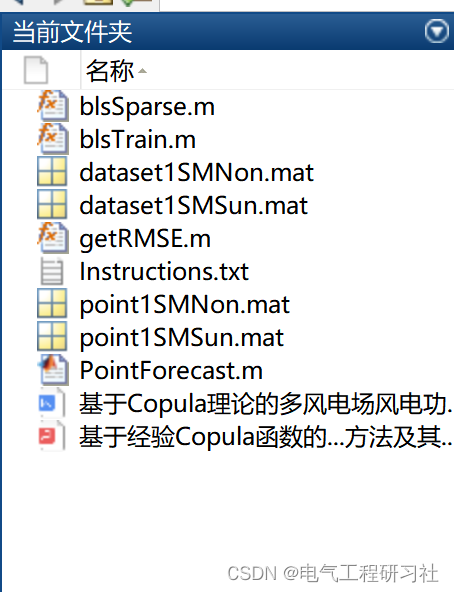

# MATLAB|Research on Spatiotemporal Dependence Modeling of Wind Power Forecasting Errors Based on Copula Theory in Multi-Wind Farms

​  
1. Overview As the ecological environment gradually deteriorates, the development and utilization of renewable energy, especially wind power, have attracted widespread global attention and continue to grow rapidly [1], [2]. However, due to the inherent randomness and volatility of wind power generation, large-scale grid connection of wind farms inevitably brings negative impacts such as voltage fluctuations and flicker to the power system [3], [4]. Moreover, there is a strong spatiotemporal correlation between the prediction errors of multiple wind farms within the same wind power base. Accurately fitting the prediction errors and accurately modeling the spatiotemporal correlation among multiple wind farms is crucial for ensuring safety and stable operation of the power system.
The prediction errors of multiple wind farms located in close geographical proximity exhibit temporal and spatial dependencies, which significantly impact the operation of power systems. To address this, this paper proposes a spatiotemporal correlation modeling method for wind prediction error based on Copula theory for multiple wind farms. Firstly, by comparing the fitting accuracy of different fitting methods, the KDE-based fitting method with the highest accuracy is selected to fit the marginal distribution of the prediction error. Then, a method utilizing Copula functions to perform high-dimensional modeling for short-term wind prediction error is proposed, resulting in the joint cumulative distribution function (JCDF) of the prediction error for multiple wind farms. Finally, the model is validated using actual prediction error data from four wind farms. Compared to the actual dependency structure, the method based on Copula functions can effectively model spatiotemporal correlations and detect the independence of wind prediction errors. The simulation results demonstrate the effectiveness of the proposed method. Mathematical Model: The Copula function provides a method for constructing joint distributions for different variables. The joint distribution includes the correlation between random variables, capturing their nonlinear correlation [8]. The Copula function is a connecting function that connects the joint distribution function of a random vector and the marginal distribution function, namely:
For detailed mathematical models and explanations, refer to Part 4.
3. Running Results Editing
Editor
Editor
4. Matlab and the article for detailed reading: This article only presents a part of the code, all codes and the article can be found in:  
Editing  
5. Conclusion: When generating dynamic scenarios for multi-wind farm outputs to solve stochastic unit combination problems based on empirical Copula functions, the operational cost is less than that from static scenarios without considering fluctuations, which enhances the economic efficiency of multi-wind farm power systems. This demonstrates the necessity and effectiveness of modeling wind power fluctuations, thereby proving the feasibility of the proposed method for generating dynamic scenarios for multi-wind farm outputs in power system unit combination.  
However, the above research did not model the temporal and spatial correlations between wind prediction errors among multiple wind farms. Therefore, this paper proposes a method for modeling the temporal and spatial correlations of wind prediction errors based on copula theory, and validates the effectiveness of the proposed model using actual wind prediction error data from four wind farms in northern Hebei. The validation results show that this method can effectively simulate the temporal and spatial correlations of wind prediction errors and detect independence among multiple wind farms. Additionally, compared with other linear correlation analysis methods, the use of copula theory for related analysis has greater advantages.  
6. References  
[1] Xu Jian, Hong Min, Sun Yuanzhang, Zhou Guohai. Method for Generating Dynamic Scenarios for Multi-Wind Farm Outputs Based on Empirical Copula Functions and Its Application in Unit Combination [J]. Power Automation Equipment, 2017, 37(08): 81-89. DOI: 10.16081/j.issn.1006-6047.2017.08.011.
[2] S. Xu, C. Liu, C. Su and C. Wang, "Correlation Analysis of Wind and Photovoltaic Power Based on Mixed Copula Theory and Its Application into Optimum Capacity Allocation," 2019 IEEE 3rd Conference on Energy Internet and Energy System Integration (EI2), 2019, pp. 976-980, doi: 10.1109/EI247390.2019.9061806.  
7 Conclusion  
​

## Images

<!-- PAYMENT_BLOCK -->

## Get this dataset

- Payment link (Stripe): [Buy now](https://buy.stripe.com/3cs8yP7sY87d0vu9AB)
- Payment QR code: 

<!-- /PAYMENT_BLOCK -->
